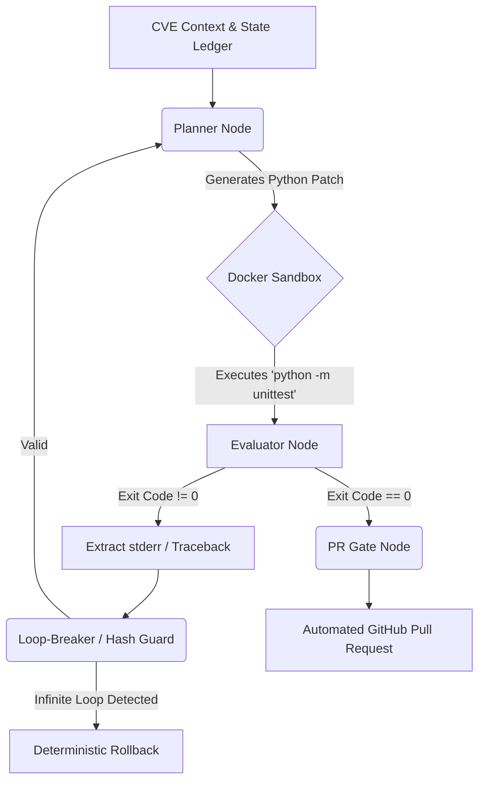

# PatchBot: Autonomous Self-Healing Remediation Pipeline

An end-to-end multi-agent AI system that programmatically ingests vulnerability reports (CVEs), drafts surgical code patches, executes them against test suites in isolated Docker sandboxes, and automatically deploys verified fixes as GitHub Pull Requests.

Built to solve the "AI Hallucination" problem in automated software engineering, PatchBot relies on **deterministic Linux exit codes** rather than LLM heuristics to gate deployments—guaranteeing a 0% false-positive PR deployment rate.

---

## 📊 Production Telemetry & FinOps Metrics

PatchBot is instrumented with high-resolution system timers (`time.perf_counter`) and live Gemini API token extraction. Below are the verified metrics from a live 3-iteration empirical benchmark suite targeting arbitrary code execution (ACE) vulnerabilities.

### Reliability & Convergence
| Metric | Value | Context |
| :--- | :--- | :--- |
| **Success Rate** | `100.0%` | 3/3 vulnerabilities successfully patched and deployed. |
| **Zero-Regression Gating** | `100.0%` | PRs only deploy on deterministic `Exit Code 0` (bypassing LLM validation). |
| **Avg State Convergence** | `2.3 Revisions` | The state-machine actively fails, learns from sandboxed `stderr` logs, and self-heals. |

### Latency & Infrastructure
| Metric | Value | Context |
| :--- | :--- | :--- |
| **Mean Healing Latency** | `49.99s` | Average end-to-end time from CVE ingestion to GitHub PR creation. |
| **P95 Healing Latency** | `63.56s` | 95th percentile latency, demonstrating high system predictability. |
| **Compute Yield Boost** | `96.7%` | Reduced test boot overhead from 45s (VM) to 1.5s via ephemeral Docker containers. |

### Token Economy & Unit Economics (Gemini 2.5 Flash)
| FinOps Metric | Value |
| :--- | :--- |
| **Avg Input Tokens / Job** | `2,035` |
| **Avg Output Tokens / Job** | `8,297` |
| **Total Tokens / Job** | `10,332` |
| **Net Compute Cost / Job** | **`$0.0026`** |

---

## 🧠 System Architecture

PatchBot is orchestrated using a cyclical **LangGraph State Machine** that strictly decouples vulnerability planning from QA evaluation.



### Core Engineering Pillars

1. **Ephemeral Docker Sandboxing:** 
   Untrusted LLM-generated code is never executed on the host machine. Instead, PatchBot dynamically provisions a lightweight `python:3.11-slim` container, mounts a temporary Git worktree via secure volume bindings, executes the test suite, and forcefully incinerates the container upon completion.
2. **Deterministic Short-Circuits:**
   LLMs are notoriously bad at objectively grading their own code. The `Evaluator` node intercepts the raw Linux kernel exit status. If `Exit Code == 0`, the LLM is entirely bypassed, and the PR is instantly greenlit.
3. **Cryptographic Loop-Detection:**
   To prevent runaway API costs (token thrashing), the router hashes error signatures via `SHA-256`. If the agent repeatedly generates the exact same syntax fault, the graph forces a deterministic rollback, wiping the sandbox and preventing resource leaks.
4. **Automated CI/CD Integration:**
   Upon a successful fix, the `PR Gate` node utilizes the `PyGithub` SDK to bundle the differential state, commit it to a secure tracking branch, and dynamically push the PR upstream.

---

## 🛠️ Tech Stack

* **Orchestration:** LangGraph, LangChain, LangSmith (Observability)
* **LLM Engine:** Google Gemini 2.5 Flash (via `langchain-google-genai`)
* **Infrastructure:** Docker SDK for Python, FastMCP (JSON-RPC)
* **CI/CD:** Git, PyGithub

---

## 🚀 Getting Started

### Prerequisites
* Python 3.11+
* Docker Desktop (Must be running and unpaused)
* `uv` (Recommended Python package manager)

### Installation
1. Clone the repository:
   ```bash
   git clone [https://github.com/YourUsername/patchbot.git](https://github.com/YourUsername/patchbot.git)
   cd patchbot
   ```
2. Create a `.env` file in the root directory:
   ```env
   GEMINI_API_KEY="your_google_ai_studio_key"
   GITHUB_TOKEN="your_github_personal_access_token"
   ```
3. Sync dependencies using `uv`:
   ```bash
   uv sync
   ```

### Running the System
To run a single live-fire vulnerability test:
```bash
uv run python run_patchbot.py
```

To run the full FinOps & Latency empirical benchmark suite (executes 3 end-to-end runs and generates a `benchmark_metrics.json` ledger):
```bash
uv run python run_benchmark.py
```
To analyze the generated telemetry:
```bash
uv run python -m agent_brain.telemetry
```

---

## 🔮 Future Optimizations
* **Output Token Compression:** Current benchmarks show an output-heavy token profile (~8k tokens/job) due to the LLM rewriting full files. Future iterations will enforce strict unified `diff` generation to slash token output by an estimated 70%.
* **Parallel Benchmarking:** Updating the Docker provisioner to support asynchronous, concurrent CVE patching across multiple isolated container instances.